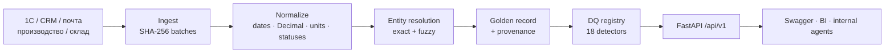
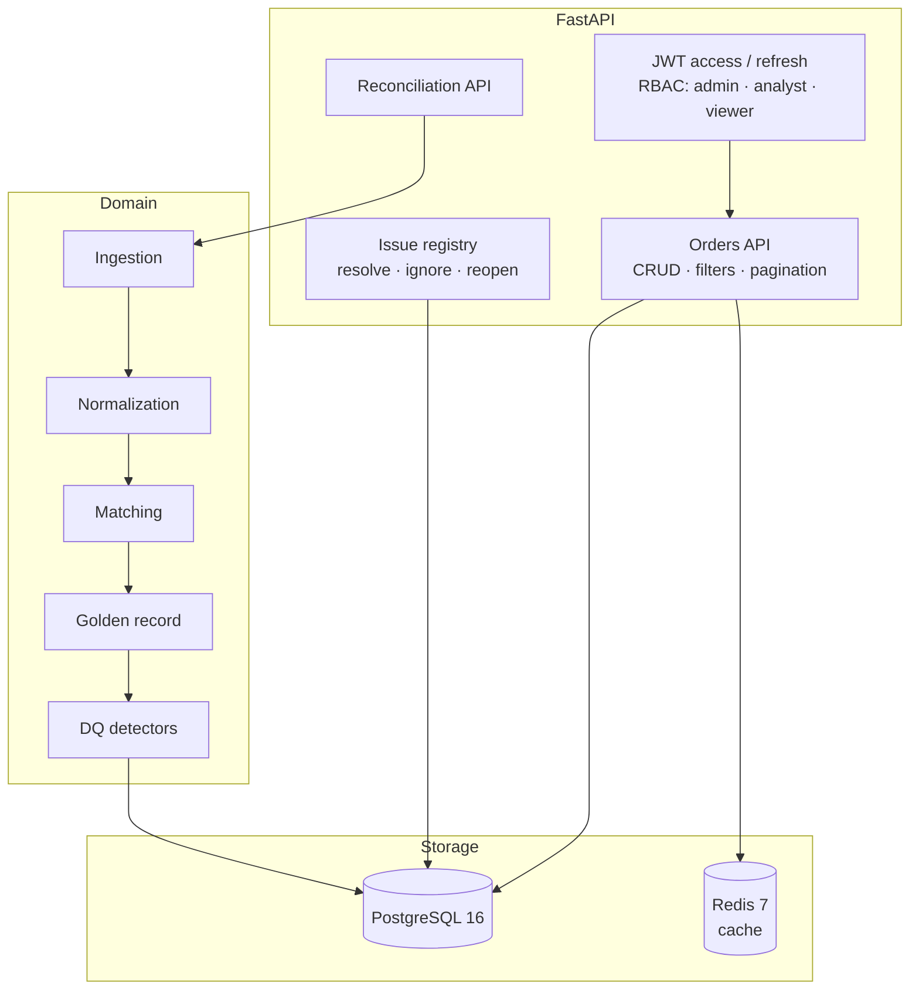

# Order Hub — интеграция заказов из пяти корпоративных систем

[](https://github.com/Nikita-Kotlyar/fastapi-order-service/actions/workflows/ci.yml)
[](https://www.python.org/)
[](https://fastapi.tiangolo.com/)
[](https://www.postgresql.org/)
[](https://redis.io/)
[](https://docs.docker.com/compose/)
[](#тесты-и-качество)
[](#тесты-и-качество)
[](LICENSE)

Сервис канонизации заказов, golden record и контроля качества данных для
производственного предприятия кабельной отрасли.

Компания и данные обезличены по требованиям NDA. Названия контрагентов,
артикулы и суммы заменены на производные значения, структура процессов и
форматы интеграции сохранены.

---

## Контекст

Заказ не существовал как единый объект: он одновременно вёлся в 1С, CRM,
почте, производстве и на складе. Общего ключа не было, статусы, даты, суммы
и единицы измерения расходились. Часть заказов существовала только в одном
источнике, часть — в двух-трёх с противоречивыми полями.

| Источник | Данные | Характерные дефекты |
|---|---|---|
| 1С | шапки и строки заказов | дубли `order_id`, четыре формата дат, десятичная запятая |
| CRM | сделки и стадии | сделки без заказа, дубли, сумма отличается от 1С |
| Почта | заявки в XLSX | `б/н`, цена за 1000 м, заказы только в почте |
| Производство | задания | orphan-заказы `PRD-*`, собственные статусы |
| Склад | заявки на отгрузку | дубли `request_id`, `UNKNOWN` вместо ключа |

**Результат:** единый канонический заказ с провенансом каждого поля и
управляемый реестр расхождений.

## Решение



- **Ingest:** CSV, JSON, XLSX; иммутабельные батчи с SHA-256 и raw-записями.
- **Normalize:** ISO, `DD.MM.YYYY`, `DD/MM/YY`, Excel serial; Decimal;
  `м`, `км`, `рулон`, `барабан`, `палетоместо`, `упаковка`, `шт`, `смеш.`;
  статусы 1С, CRM, производства и склада; SKU и клиенты.
- **Entity resolution:** точные ключи и fuzzy-матчинг «клиент + дата ±1 день + SKU»
  с порогом 0.85.
- **Golden record:** приоритет `1С → CRM → почта → производство → склад`;
  деньги только `Decimal`; провенанс по каждому полю.
- **DQ:** дубли, конфликты статусов, единицы, суммы, отрицательные количества,
  orphan-записи, противоречивые коэффициенты, неоднозначные даты и совпадения.
- **API:** CRUD, фильтры, пагинация, кэш, JWT, роли, история статусов, CSV export,
  OpenAPI 3.1.

## Архитектура



Подробно: [docs/ARCHITECTURE.md](docs/ARCHITECTURE.md) — ER-диаграмма,
sequence-диаграммы, правила матчинга, матрица ролей.

## Результаты

| Метрика | Значение |
|---|---:|
| Канонические заказы | **580** |
| Покрытие: 1С / CRM / почта / производство / склад | 400 / 309 / 183 / 250 / 200 |
| Проблемы качества данных | **993** |
| Точные наборы источников | 578 / 580 |
| Неоднозначные пары, отправленные на ручной разбор | 2 |
| Повторная сверка | без дублей, те же canonical ID |

Основные категории расхождений: `unit_mismatch` — 206, `total_mismatch` — 133,
`contradictory_conversion` — 100, `missing_customer` — 64, `duplicate_1c` — 50,
`orphan_production` — 50, `email_only` — 50, `status_conflict` — 46,
`unknown_sku` — 44, `negative_qty` — 29.

### Операционный эффект

- Единый API и golden record вместо пяти несогласованных представлений заказа.
- 993 расхождения переведены из переписок и ручных сверок в управляемый реестр
  с приоритетом, владельцем и статусом разбора.
- Повторная сверка не создаёт дублей: canonical ID и issue keys детерминированы.
- Ручные заказы, история статусов и audit trail доступны через API и PostgreSQL.
- Роли `viewer` / `analyst` / `admin` разграничивают чтение, разбор и администрирование.

## Стек

| Слой | Технологии |
|---|---|
| Язык и API | Python 3.12+, FastAPI, Pydantic v2, OpenAPI 3.1 |
| Данные | PostgreSQL 16, SQLAlchemy 2.x, Alembic |
| Кэш | Redis 7, TTL, `X-Cache: HIT/MISS` |
| Безопасность | JWT access/refresh, PBKDF2-SHA256, RBAC |
| Инфраструктура | Docker, Docker Compose, healthcheck, non-root container |
| Качество | pytest, coverage 90.8%, ruff, GitHub Actions |
| Поставка | Compose deploy script, GHCR release workflow |

## Быстрый старт

```bash
uv venv .venv
uv pip install --python .venv/Scripts/python.exe -e ".[dev]"

cp .env.example .env
# Заполни ORDERHUB_JWT_SECRET и пароли bootstrap-пользователей.
.venv/Scripts/alembic.exe upgrade head
.venv/Scripts/python.exe -m app.cli seed
.venv/Scripts/python.exe -m app.cli reconcile --run-date 2026-11-05
.venv/Scripts/python.exe -m app.cli serve --port 8080
```

Swagger: <http://127.0.0.1:8080/docs>.

Быстрый старт использует SQLite; Docker Compose переключает сервис на PostgreSQL 16.
По умолчанию используется `data/reference` — эталонный набор из 16 заказов
для воспроизводимого запуска и интеграционных тестов. Для рабочего набора
выгрузок укажи каталог:

```bash
SOURCE_DATA_DIR=/data/source \
.venv/Scripts/python.exe -m app.cli reconcile --source-dir "$SOURCE_DATA_DIR" --run-date 2026-11-05
```

## Docker Compose

```bash
docker-compose up -d --build
docker-compose ps
docker-compose exec api orderhub seed
docker-compose exec api orderhub reconcile --run-date 2026-11-05
```

Compose поднимает PostgreSQL 16, Redis 7 и API на `:8080`. Пароль PostgreSQL
обязателен и задаётся через `POSTGRES_PASSWORD` в `.env`/секрет-менеджере.
Каталог выгрузок задаётся через `SOURCE_DATA_DIR`; по умолчанию монтируется
`data/reference`. Для рабочего каталога:

```bash
SOURCE_DATA_DIR=/data/source docker-compose up -d --build
```

Остановка: `docker-compose down` (данные PostgreSQL сохраняются в volume `pgdata`).

## Аутентификация и роли

Bootstrap-пользователи создаются из переменных `ORDERHUB_*_PASSWORD` при
`ORDERHUB_SEED_DEFAULT_USERS=true`. Пароли и JWT-секрет задаются через
секрет-менеджер и меняются после первого входа. В репозитории секретов нет.

| Роль | Чтение | PATCH/status | Issues | Reconcile | CRUD orders | Users |
|---|---|---|---|---|---|---|
| `viewer` | ✅ | — | — | — | — | — |
| `analyst` | ✅ | ✅ | ✅ | ✅ | — | — |
| `admin` | ✅ | ✅ | ✅ | ✅ | ✅ | ✅ |

Токены: access — 60 минут, refresh — 7 дней. Роли проверяются по актуальной
записи пользователя в PostgreSQL, а не только по claims.

## API

| Метод | Путь | Назначение |
|---|---|---|
| POST | `/api/v1/auth/token` | access + refresh JWT |
| POST | `/api/v1/auth/refresh` | обновление пары токенов |
| GET | `/api/v1/auth/me` | текущий пользователь и роли |
| GET/POST | `/api/v1/auth/users` | список / создание (admin) |
| PATCH | `/api/v1/auth/users/{id}` | пароль, роли, активность (admin) |
| GET | `/api/v1/orders` | фильтры, пагинация, `X-Cache` |
| POST | `/api/v1/orders` | ручной заказ `CO-MAN-*` (admin) |
| GET/PATCH/DELETE | `/api/v1/orders/{id}` | деталь, правка, удаление (admin — delete) |
| POST | `/api/v1/orders/{id}/status` | переход статуса + история |
| GET | `/api/v1/orders/export` | CSV в формате эталона |
| GET | `/api/v1/orders/stats` | агрегаты |
| GET | `/api/v1/issues` | реестр расхождений |
| POST | `/api/v1/issues/{id}/resolve\|ignore\|reopen` | ручной разбор |
| POST | `/api/v1/reconciliation/runs` | сверка `reference` / `full`, `dry_run` |
| GET | `/api/v1/imports` | история батчей |
| GET | `/api/v1/customers`, `/products`, `/unit-conversions` | мастер-данные |
| GET | `/health`, `/ready`, `/metrics` | эксплуатация |

Пример:

```bash
TOKEN=$(curl -s -X POST http://127.0.0.1:8080/api/v1/auth/token \
  -d "username=admin&password=$ORDERHUB_ADMIN_PASSWORD" | jq -r .access_token)

curl -H "Authorization: Bearer $TOKEN" \
  "http://127.0.0.1:8080/api/v1/orders?status=in_production&has_issues=true&limit=5"
```

Ошибки единообразны, каждый ответ содержит `X-Request-ID`:

```json
{"error": {"code": 404, "message": "Order not found", "request_id": "..."}}
```

## Надёжность и данные

- **Идемпотентность:** повторный ingest и сверка не создают дублей; canonical ID
  и issue keys детерминированы.
- **Провенанс:** для каждого поля заказа хранится источник и confidence.
- **Ручные заказы:** `CO-MAN-*` не участвуют в матчинге и переживают пересборку.
- **История статусов:** `order_status_history` фиксирует переход, автора и комментарий.
- **Аудит:** `audit_events` для логинов, изменений заказов, issue и пользователей.
- **Ошибки:** единый JSON-envelope, request id, логирование.
- **Миграции:** три ревизии Alembic, `alembic check` без drift.

## Кэш и наблюдаемость

- Redis или in-memory fallback; TTL настраивается.
- `X-Cache: HIT|MISS` на list/detail.
- Инвалидация при записи заказа, issue, сверке и изменении пользователей.
- `/metrics`: заказы, проблемы, импорты, cache hits/misses, backend.
- `/ready` проверяет PostgreSQL и кэш.
- Structured request log с `X-Request-ID`.

## Тесты и качество

```bash
pytest -q -m "not integration" --cov=app --cov-fail-under=80
pytest -q   # + полный интеграционный набор, если задан ORDERHUB_INTEGRATION_DIR
```

- **53 теста** на полном наборе данных; один из них требует Redis и запускается в CI с `redis:7`.
- **42 теста** в CI без интеграционного набора.
- **Coverage 90.8%**, порог 80% в CI.
- Unit: даты, Decimal, единицы, статусы, имена.
- API: CRUD, JWT, refresh, RBAC, пагинация, кэш, ошибки, OpenAPI.
- Integration: 580 заказов, покрытие источников, recall эталонных проблем.
- Reference dataset: 16 заказов и 26 проблем, воспроизводимый прогон.

## CI/CD

GitHub Actions (`.github/workflows/ci.yml`):

| Job | Проверка |
|---|---|
| `sqlite` | format, lint, миграции, `alembic check`, тесты + coverage |
| `postgres` | миграции и тесты на PostgreSQL 16 |
| `redis` | тесты с реальным Redis 7 |
| `docker` | сборка образа и валидация Compose |

Поставка:

```bash
SOURCE_DATA_DIR=/data/source bash scripts/deploy.sh
```

Скрипт собирает образ, применяет миграции, создаёт мастер-данные, выполняет
сверку и проверяет `/health`. Публикация контейнера в GHCR описана в
`.github/workflows/release.yml`.

## Структура

```text
app/
  api/            # FastAPI-маршруты
  auth.py         # JWT, RBAC, bootstrap users
  security.py     # PBKDF2
  services/       # reconciliation + persistence
  ingestion/      # readers, source loaders, master data
  normalization/  # dates, money, units, statuses, names
  matching/       # entity resolution, golden record
  dq/             # типы и severity проблем
  models.py       # SQLAlchemy 2.x
  schemas.py      # Pydantic v2
alembic/          # 3 ревизии
data/reference/   # эталонный набор для интеграционных тестов
docs/             # ARCHITECTURE.md, RUNBOOK.md, TECH_AUDIT.md, openapi.json
scripts/          # reference generator, deploy
tests/            # unit, API, integration, coverage
```

## Документация

- [Архитектура и ER-диаграмма](docs/ARCHITECTURE.md)
- [Runbook: запуск, миграции, backup, troubleshooting](docs/RUNBOOK.md)
- [Аудит технологий и интеграционная проверка](docs/TECH_AUDIT.md)
- [Architecture Decision Records](docs/adr/README.md)
- [OpenAPI 3.1](docs/openapi.json)
- [Contributing](CONTRIBUTING.md) · [Security](SECURITY.md) · [Changelog](CHANGELOG.md)

## Принятые решения и ограничения

- Нет коэффициента «рулон → м» в регламенте: соглашение 100 м с confidence 0.6.
- Для `шт` коэффициент не задаётся: строка уходит в `missing_conversion`.
- У КВВГ два противоречивых коэффициента барабана (300 и 500): issue + выбор 300.
- Даты `DD/MM/YY`, где обе части ≤ 12, помечаются `ambiguous_date`.
- CRM-сумма не перезаписывает 1С; расхождение — отдельный сигнал.
- Эталонный генератор содержит исторические false positives; сервис фиксирует
  реальные дефекты, а не подгоняется под эталон.
- Ручные заказы `CO-MAN-*` не участвуют в матчинге и DQ.
- JWT: нет revocation и rotation refresh-токенов; роли без гранулярных permissions.
- Поставка публикует образ, но не разворачивает инфраструктуру в Kubernetes/облаке.

## Roadmap

1. `MatchCandidate` и очередь ручного подтверждения для score 0.60–0.85.
2. Merge/split заказов и split ошибочных связей.
3. Token revocation, refresh rotation, история входов.
4. Prometheus-гистограммы, OpenTelemetry-трейсы.
5. Kubernetes/Helm и Terraform-деплой.

## Лицензия

MIT.
