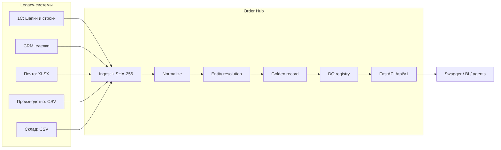
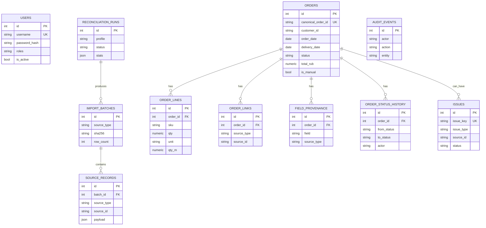
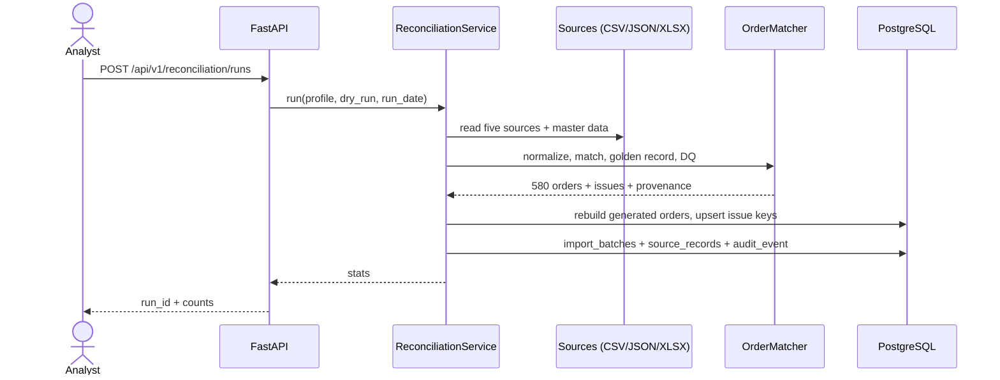
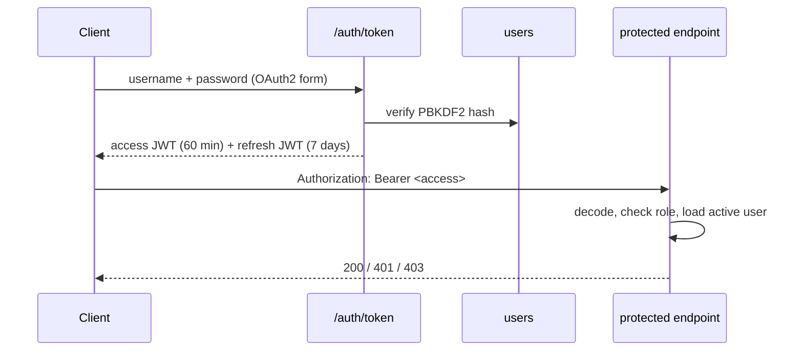

# Архитектура Order Hub

## Назначение

`fastapi-order-service` — industrial order hub для производственного предприятия
кабельной отрасли. Название компании и данные обезличены по требованиям NDA.
Сервис собирает заказ из пяти корпоративных систем, нормализует поля, строит
golden record, хранит провенанс и ведёт реестр расхождений.

## Контекст

## Слои

| Слой | Пакет | Ответственность |
|---|---|---|
| HTTP | `app/api` | маршруты, пагинация, роли, OpenAPI |
| Auth | `app/auth.py`, `app/security.py` | JWT access/refresh, PBKDF2, RBAC |
| Services | `app/services` | запуск сверки, persistence, audit |
| Ingestion | `app/ingestion` | чтение CSV/JSON/XLSX, нормализация источников, мастер-данные |
| Matching | `app/matching` | entity resolution, golden record, провенанс |
| Normalization | `app/normalization` | даты, Decimal, единицы, статусы, имена, SKU |
| DQ | `app/dq` | типы проблем, severity, описания |
| Data | `app/models.py`, `alembic` | SQLAlchemy-модели и миграции |
| Infra | `Dockerfile`, `docker-compose.yml`, `.github` | PostgreSQL, Redis, CI, CD |

## Модель данных

## Поток сверки

## Матчинг

1. **Точные ключи:** `order_id`, `source_order`, `order_ref`, `deal_id`, `email_id`, `request_id`.
2. **Fuzzy для почты без ссылки:** нормализованный клиент + дата ±1 день + SKU, порог `0.85`.
3. **Карантин:** `UNKNOWN`, `PRD-*`, неразрешимые ссылки не создают golden record.
4. **Приоритет полей:** 1С → CRM → почта → производство → склад.
5. **Деньги:** только `Decimal`, CRM-сумма не перезаписывает 1С.
6. **Повторный запуск:** canonical ID детерминированы, issue keys стабильны,
   ручные заказы `CO-MAN-*` и статусы `resolved/ignored` сохраняются.

## Авторизация

| Роль | Чтение | PATCH/status | Issues | Reconcile | CRUD orders | Users |
|---|---|---|---|---|---|---|
| `viewer` | ✅ | — | — | — | — | — |
| `analyst` | ✅ | ✅ | ✅ | ✅ | — | — |
| `admin` | ✅ | ✅ | ✅ | ✅ | ✅ | ✅ |

## Кэш

- Ключи: `orderhub:orders:<hash>` и `orderhub:order:<hash>`.
- TTL: `ORDERHUB_CACHE_TTL_SECONDS` (по умолчанию 60 с).
- Инвалидация: любая запись в заказ, issue, reconciliation или пользователя.
- Заголовок `X-Cache: HIT|MISS`; счётчики в `/metrics`.
- Redis опционален: без `ORDERHUB_REDIS_URL` используется in-memory TTL.

## DQ-детекторы

`duplicate_1c`, `status_conflict`, `unit_mismatch`, `missing_customer`, `unknown_sku`,
`total_mismatch`, `negative_qty`, `orphan_production`, `orphan_warehouse`, `email_only`,
`duplicate_crm`, `duplicate_warehouse`, `mixed_unit`, `missing_conversion`,
`contradictory_conversion`, `coverage_gap`, `ambiguous_date`, `ambiguous_match`.

## Ограничения

- Эталонный файл полного интеграционного набора содержит исторические false positives
  (блочная формула генератора);
  сервис фиксирует реальные дефекты, а не подгоняется под эталон.
- Нет полноценного token revocation и rotation refresh-токенов.
- Нет merge/split заказов и очереди `MatchCandidate` для спорных совпадений.
